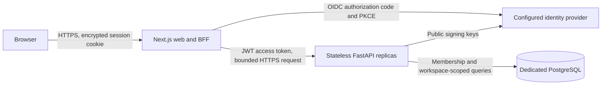

# Architecture and release boundary

## As-built scope

The product owns two independently deployable runtimes. Neither reads the
Solo Empire hub or another cell's database. Production operational records
belong to a dedicated PostgreSQL database, not a local file or SQLite.

## Decisions

**ADR-01: FastAPI with PostgreSQL.** The owner requested a scalable backend and
explicitly rejected SQLite/local-only storage. Database migrations are an
explicit release step. An API replica does not initialize a new database or
keep financial records on its filesystem.

**ADR-02: One product repository, two deploy units.** The web and API have their
own manifests, checks and deployment configuration. The shared repository is
the product boundary, not a shared runtime with the Solo Empire hub. The web
can deploy on Vercel and the API on Railway without requiring the other's process.

**ADR-03: OIDC plus stored membership.** The identity provider authenticates a
user. The API validates its JWT access token and checks database membership
for the requested workspace. A token's workspace claim, a URL ID, or an
unverified browser session is not a permission grant.

**ADR-04: Integer money, explicit currencies.** Minor units are integer values
in storage and decimal strings on the wire. Work time uses integer minutes.
Labor rounds per entry, half-up, using the rate recorded on that entry.
Different currencies have separate totals; there is no implicit conversion.

**ADR-05: Idempotent recording.** A create submission carries an idempotency
key. Its saved response and financial write are transactional. An explicit
retry of the same operation must not create another payment, expense or time entry.

## Trust and data boundaries

- Browser input is untrusted and validated again at the API.
- The web keeps upstream tokens encrypted in HttpOnly cookies and does not
  hand them to client components.
- The BFF permits a fixed set of API routes, uses one configured upstream,
  rejects unsafe origins, and does not follow redirects.
- The API verifies signature, algorithm, issuer, audience and token lifetime.
- Every project and entry query is scoped to an authorized workspace.
- Financial records and client names are confidential business data. Test
  records and identities are synthetic.
- Production logs must not contain tokens, cookies, request payloads, SQL
  parameters or database connection strings.

## What scaling means here

Horizontal API replicas share PostgreSQL rather than process memory or
container disks. Connection pools are bounded per replica. Database-backed
idempotency remains valid across replicas. Authentication and authorization
are repeated on every private request. Project and entry lists are paginated,
and financial summaries include all matching records rather than one displayed page.

These properties are testable architecture claims, not a throughput benchmark.
No production traffic, p95 latency, availability, autoscaling or recovery
objective has been measured yet. A load test, database connection budget and
provider limits must be set for the approved deployment before commercial launch.

## Release gates

1. Package checks and real PostgreSQL integration tests pass.
2. Browser component tests pass at desktop and mobile sizes.
3. Independent security/correctness and visual reviews have no blocking findings.
4. The owner approves provisioning and the target environments.
5. The identity provider issues JWT access tokens for the API's configured
   audience; frontend login and workspace isolation are smoke-tested there.
6. A dedicated database is migrated, backup/recovery is configured, and runtime
   roles and TLS requirements are checked.
7. Web and API readiness plus an authenticated create/read/retry workflow pass
   against the approved environment.
8. Edge request/concurrency limits and identity quotas are configured before
   public signup. Define financial/audit retention and idempotency-key pruning
   with a documented retry window; no automatic pruning job exists yet.

The web has no application CSP or HSTS header yet. Configure HTTPS enforcement
at the host and approve a nonce-compatible CSP before public launch; do not
add a policy that breaks Next.js hydration or the configured identity flow.

No provider resource, production deployment or commercial readiness is implied
by source code or a passing offline test.
